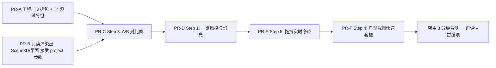

# 下一轮开发指导（2026-11-25 起）

> 本文是 [Codex 下一步开发指南](codex-next-steps.md) 的执行版：那份文档定义产品边界、不变量和暂缓项，本文给出 **#16 合并之后** 的具体开发顺序、技术方案、拆分方式与验收标准。两者冲突时以 `codex-next-steps.md` 的「不变量」为准。

## 0. 当前基线

| 项 | 状态 |
| --- | --- |
| 主干 | 已合并 #15/#16/#17；基于 PR-B（#18）完成 PR-C（Step 3：A/B 双方案一图对比导出） |
| 首稿链路 | 新建铺位 → 输入尺寸 / 画轮廓 → 后台 Worker 试排 → 直接打开分屏第一稿 |
| 候选 | `generateBasicLayoutCandidates` 每个图上厨位保留一份高分试排，按家具坐标去重，最多 3 份；会话内缓存于 `draftChoices.ts`，项目包仍为格式 7 |
| 出图 | 平面 PNG、3D 鸟瞰/室内/门头、2400×1500 单方案合图与 **A/B 双方案对比图**（同铺优先筛选 + 离屏只读拍摄）；复制剪贴板与下载 |
| 验证 | `pnpm typecheck`、`pnpm build`、`pnpm test`（几何含 sameShop + 生产版 Chromium 含 basic-layout / editable-draft / quick-export A/B 对比 / offscreen-render） |

### #16 审计遗留（已在合并前修复）

- 原地「应用摆法」在会话候选失效时静默返回 → 现提示「候选摆法已失效，请重新比较或另存为新稿」，并清空候选。
- 厨位标签缺少单独断言 → `tests/basic-layout.mjs` 新增「后厨分区面积加权中心与 `后厨在图{上方|左侧|下方|右侧}` 一致」的断言。

### 仍未处理、可随后续 PR 顺手完成

| 编号 | 问题 | 建议 |
| --- | --- | --- |
| T1 | `draftSnapshot` 每次对整份项目 `JSON.stringify`，300 件场景下打开比较/应用会有可感知开销 | 在 store 中维护单调递增的 `revision`（`commit`/`undo`/`redo` 时 +1），用 `project.id + revision` 代替整份快照；候选缓存键同步改造 |
| T2 | `draftChoices.ts` 为模块级单例，只记得最后一个项目的候选 | 改为 `Map<projectId, …>`，上限 3 个项目（LRU），切回项目仍能原地应用 |
| T3 | 主包压缩后 > 500 kB（three / drei / fiber） | 3D 视图、`SceneCapture`、`ImageExport` 合图逻辑改为 `React.lazy` + 动态 `import()`；纯 2D 首屏不加载 three |
| T4 | `pnpm test` 只显示两个入口，子套件失败时定位慢 | 新增 `test:geometry`、`test:browser` 脚本；CI 中分 step 运行，失败时上传 `.local-checks/` 截图 |

T1/T2 属于 Step 3 的前置条件（见下），T3/T4 可以单独一个工程 PR。

---

## 1. 开发顺序总览

**规则**：每个 PR 只做一格；PR-B 是纯重构，不改任何用户可见行为，必须先于 PR-C 合并。

---

## 2. PR-B：只读渲染层（Step 3 前置重构）

### 问题

`Scene3D.tsx` 与 `SceneCapture.tsx` 直接读取 `useStore(s => s.project)`，平面截图 `capturePlan(svg, project)` 依赖当前画布 SVG。要拍摄「非当前项目」只能临时切换 store，会污染撤销栈、选区并触发 IndexedDB 自动保存——违反不变量 2。

### 方案

1. 把 3D 场景内容抽成纯组件 `SceneContent({ project, interactive })`：`project` 由参数传入；`interactive=false` 时不订阅选区、不挂拖拽/悬停处理、不渲染 `selection-highlight`。现有 `Scene3D` 改为 `SceneContent project={useStore(...)} interactive`，行为保持不变。
2. 新增 `src/OffscreenStage.tsx`：在 `document.body` 下挂一个 `position:fixed; left:-10000px` 的 1600×1000 `<Canvas preserveDrawingBuffer>`，渲染 `SceneContent interactive={false}`，暴露与 `SceneCaptureAPI` 同形的 `captureShot(kind)`；用完卸载并 `gl.dispose()`。
3. 平面：`PlanMiniPreview` 已是纯 `project` 渲染，补一个 `capturePlanFromProject(project, { header })`，在离屏 SVG 中渲染后复用 `capturePlan` 的栅格化逻辑。
4. 底图资产：离屏渲染需要按 `underlay.assetId` 从资产库读取；读取失败时与现有逻辑一致抛出「底图未加载完成或资产缺失」。

### 验收

- 现有全部测试零改动通过（纯重构）。
- 新增几何/浏览器断言：对示范案例分别用旧路径和 `OffscreenStage` 拍鸟瞰，两张 PNG 尺寸一致、非空白像素比例差 < 2%。
- 离屏拍摄前后 `useStore.getState()` 的 `project`、`past/future` 长度、`selectedIds` 深度相等；IndexedDB 中该项目 `updatedAt` 不变。

---

## 3. PR-C：Step 3 —— A/B 双方案一图对比（P0）

### 用户流程

1. 「导出图片」弹窗新增格式「A/B 对比图」。
2. 方案 A = 当前项目；方案 B 下拉列出项目库中的**同铺方案**（见下方判定），默认选最近更新的一份；无同铺方案时提示「先在『比较摆法』中另存一稿」并给出按钮直达。
3. 预览 → 复制图片 / 下载 PNG，文件名 `铺名-AB对比-YYYYMMDD.png`。

### 同铺判定（`src/sameShop.ts`，纯函数，需单测）

两份项目满足以下全部条件视为同铺：

- `survey.corners` 经平移归一后逐点相等（容差 ±10 mm），或面积差 < 0.5% 且外轮廓 IoU > 0.98；
- 入口标记（`pointType === 'entrance'`）位置差 < 200 mm；
- 固定构件（柱、管井、隔间等 `verification` 存在或 `generated !== 'concept'` 且锁定的构件）ID 集合相同、坐标差 < 10 mm。

仅面积相同不算同铺。判定失败时仍允许用户手动选择，但卡片标注「轮廓不同，仅供参考」。

### 画面规格（2400 × 1500）

| 区域 | 内容 |
| --- | --- |
| 顶栏 120 px | 铺名、净面积；结论一句话，如「B 比 A 多 2 座，最窄间距宽 360 mm」 |
| 左/右两栏 | 各一张无页眉平面（上，约 1140×640）+ 整店鸟瞰（下，约 1140×560）；栏顶角标「方案 A」「方案 B」 |
| 底栏 | 指标表：座位数、桌数、餐厨面积比、最窄桌组间距、预算区间；优势项加粗绿色 |

指标来源：座位 `seatSummary`，间距 `nearestTableGap`，餐厨比与预算 `analyzeShop`（`shopAnalytics.ts`）。所有数值从两份项目实时计算，不读缓存。

### 实现要点

- 合图绘制放到 `src/makeCompareSheet.ts`，与现有 `makeSheet` 共用字体、配色和 `maxWidth` 文本截断工具。
- B 通过 PR-B 的 `OffscreenStage` + `capturePlanFromProject` 拍摄；A 可走现有路径以复用已缓存截图。
- 切换 B 或切换风格时作废已缓存的 B 图与合图；A 的缓存沿用 `ImageExport` 现有失效规则。
- 失败（资产缺失、WebGL 上下文丢失）时显示错误并保留「重试」，不得留下离屏 Canvas。

### 验收

- `tests/quick-export.mjs`：从空白画布生成首稿 → 比较摆法另存一稿 → 回到原稿导出 A/B 对比图；校验 PNG 为 2400×1500、剪贴板类型 `image/png`、指标表中座位数与两份项目 `seatSummary` 一致。
- 关闭弹窗后：当前项目、撤销历史长度、视图模式、选区与打开前完全一致；B 项目 `updatedAt` 未变化。
- `tests/shop-geometry.mjs`：`sameShop` 覆盖同铺、镜像铺、同面积不同轮廓、入口移动、固定构件移动 5 种情形。

---

## 4. PR-D：Step 1 —— 一键风格与灯光（P0）

### 方案

- 复用 `decorThemePresets`（`conceptPlanner.ts`）中的 5 个预设，界面只展示 4 个胶囊：原木暖调 / 晚市小馆 / 明亮快餐 / 毛坯实测；另有「自然光 / 暖光营业」切换（`lightingPreset: 'daylight' | 'warm-dining'`）。
- 入口：`BasicDraftBar` 一行胶囊；`ImageExport` 弹窗顶部同一组胶囊。不新增弹窗。
- 写入：仅 `commit({ ...project, style: { ...project.style, floorMaterial, wallMaterial, lightingPreset } })`，一次撤销恢复；**禁止**改动 `items`、`groups`。
- 首稿默认风格：`businessTypeDefaults` 增加可选 `themeId`，基础草稿生成后若项目 `style` 仍为默认值则套用（面馆/轻食→原木暖调，快餐/食堂→明亮快餐）。用户已手动设置过材质的项目不覆盖。
- 合图缓存：风格变化即作废所有 3D 截图和合图，平面 PNG 不受影响。

### 验收

- 切换风格前后 `items` / `groups` 深度相等，`seatSummary` 不变；撤销一次 `style` 回到切换前。
- `quick-export.mjs`：导出弹窗内切换风格后，合图重新生成且鸟瞰 PNG 像素哈希与切换前不同。
- 旧项目包（无 `style` 或部分字段）回读后显示「毛坯实测」或其当前材质，不报错。

---

## 5. PR-E：Step 5 —— 拖拽实时净距（P1）

### 方案

- 在 `PlanEditor.tsx` 的拖拽回调中，用拖动对象（桌组或单件）当前包围框外扩 `clearance + 600 mm` 做粗筛，只与命中的家具和 `surveyWall()` 墙段计算最近边距，复用 `spaceChecks.ts` / `wallClearance.ts` 的距离函数。
- 渲染：一条细标尺线 + 毫米数字，`< project.clearance` 时警示色；松手即移除。显示逻辑放到独立的 `DragClearanceOverlay.tsx`，避免继续膨胀 `PlanEditor.tsx`。
- 计算节流到 `requestAnimationFrame`，同一帧只算一次。

### 验收

- `prd-performance.cjs` 300 件场景拖动：平均帧耗时不劣于基线 +2 ms，p95 不超过 16.7 ms。
- 浏览器测试：将桌组拖近另一桌组至 < 参考净距，断言标尺可见且带警示类名；松手后消失；撤销一次回到拖前位置。

---

## 6. PR-F：Step 4 —— 户型截图快速套框（P1）

### 方案

- 「从户型图描绘」完成两点校准后出现浮条：「按尺寸套矩形」「按尺寸套 L 形」「沿底图点角」。
- 套框复用 `#13` 的 `dimensionedOutline(width, depth, cutout)`；出现后可整体拖动、四角/缺口边拖拽调整，数值框同步显示净尺寸。
- 确认后直接调用 `requestLayoutCandidates` 生成第一稿，与输入尺寸链路一致。
- 底图半透明滑块与「出图时隐藏底图」开关保留；隐藏时平面与 3D 截图均不含底图。

### 验收

- 测试户型图（已知一段墙长）：矩形与 L 形各记录点击次数，目标矩形 ≤ 6 次、L 形 ≤ 9 次完成到首稿。
- 隐藏底图导出的平面 PNG 中无底图像素（与隐藏前做像素差）；资产缺失时给出明确错误。

---

## 7. 不在本轮范围

沿用 `codex-next-steps.md` 第三节：框选生成桌阵、可拖动餐厨分界线、`PlanEditor.tsx` 大规模图层拆分、安装方式字段全量迁移。PR-E 中新增独立 overlay 组件属于局部拆分，允许。

项目格式保持 7。若某个 PR 确需持久化新字段（例如风格来源标记），字段必须可选，并在 `projectIO.ts` 的解析与旧包回读测试中覆盖。

---

## 8. 每个 PR 的提交清单

1. `pnpm typecheck && pnpm build && pnpm test` 全部通过，并在 PR 描述中贴出结果。
2. 新逻辑有对应断言；不删减已有断言，改文案时同步更新测试与 README。
3. 涉及项目切换、导出或候选的改动，必须断言「当前项目、撤销历史、选区、IndexedDB `updatedAt`」未被意外修改。
4. PR 描述写清：店主可感知的变化、主要文件、验证项、已知取舍；依赖其他 PR 时写明合并顺序。
5. 完成后在本文「当前基线」表格中更新状态，并在 `docs/README.md` 索引中保持描述准确。
